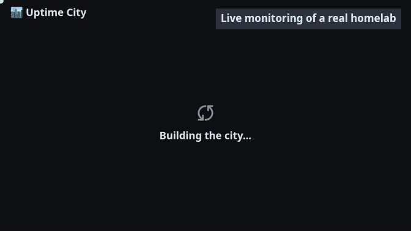

# uptime-city

Uptime city is an uptime monitoring tool focused on visualization through a cityscape like picture



> [!IMPORTANT]
> This project is part of my corporate training on AI and more specifically Claude Code usage: mastering context-engineering, harness engineering, and good practises using agents in general
>
> I made some opinionated choices: 
>   - Use technologies I don't know very well (Except for Python) like FastAPI, VueJS and ThreeJS
>   - Avoid writing any line of code. I only wrote a bit of documentation here and there. Most (if not all) of the code was generated by Claude.
>   - Try and be careful with token usage: use simple sub-agents when possible, being the most accurate and use carefully splitted features
>

> [!NOTE]
> According to the [ecologits](https://ecologits.ai/latest/) statusline, at time of writing this **(25/10/26)**, this project has consumed the following resources:
> 🔥 4.92 kgCO₂ 💧 45.55 L ⚡ 10.10 kWh


## ✨ Features

- 🔎 **Probing**
  - 🌐 **HTTP(S), TCP and ICMP checks**: each target is probed at the interval of your choice, with its own timeout.
  - ✅ **Conditions**: a check passes only when its conditions hold, such as `[STATUS] == 200` or `[RESPONSE_TIME] < 500`.
  - 🏘️ **Hosts, VMs and services**: physical hosts hold vm-hosts and services; while a host is down, its services are not probed and show as down.
  - 💾 **History storage**: results are kept for 30 days by default in SQLite or memory, and reloaded on restart (PostgreSQL is not supported yet).
- 🧭 **UX**
  - 🔍 **Focus view**: click a neighbourhood to zoom in, then a building to open a panel with each service's status and its latest checks as bars.
  - 📈 **Response-time graphs**: a movable, resizable graph of each service's latest response times, with its outages marked.
  - 📊 **Map totals and status lists**: green, red and orange badges count the services that are up, down or unknown, and a click lists them.
  - 🎛️ **Menus**: toggle the labels and effects, set the density of vehicles and clouds, pick a detail level and a refresh period; your choices are saved in the browser.
  - 🎲 **City regeneration**: a toolbox button draws a new layout of the city, kept by the backend.
  - 🧪 **Simulation mode**: fakes consistent statuses instead of probing anything, and lets you trigger outages and recoveries by hand (nuke a host, demolish services, revive them, reset).
- 🎨 **UI**
  - 🏙️ **Isometric 3D city**: each physical host is a neighbourhood, each vm-host a building, each service a named floor, on one continuous map you can drag and zoom.
  - 🌲 **Biomes**: forests, mountains, cities, coastal cities, deserts and tundras blend into each other, with ponds, snow, houses, tennis clubs and stadiums.
  - 🛣️ **Life on the map**: roads, roundabouts and paths with cars, trucks and motorcycles, a railway with passenger, freight and TGV trains, and an airport with planes landing and taking off.
  - ⛈️ **Weather**: clouds drift over the map, some rain and some bring thunderstorms with lightning.
  - 🔥 **Outage animations**: a failing service explodes and burns on its floor, and a host that goes down sees its building collapse into smoking rubble while fire trucks come to hose it.
  - ☢️ **Nuclear strike**: a physical host that goes down gets its neighbourhood nuked by a missile, followed by a mushroom cloud.
  - 🏗️ **Recovery animations**: a recovering service lights up green, a rebuilt building goes up floor by floor inside a scaffolding beside a crane, and a shock wave of light restores a nuked neighbourhood.
- 🐳 **Self-hosting**
  - 📦 **Docker images and docker compose**: ready-made images and a compose example, with no authentication to set up.

## Run locally

Copy the example config and adapt it to your own hosts (see `backend/README.md`), start the backend, then the frontend:

```sh
cp backend/example/config.example.yaml backend/example/config.yaml
cd backend && uv run uptime-city --config example/config.yaml
cd frontend && pnpm dev   # http://localhost:5173
```

See `backend/README.md` and `frontend/README.md` for details.

## Self host

Release images are published to the GitHub container registry: `ghcr.io/matthieusb/uptime-city-backend` and `ghcr.io/matthieusb/uptime-city-frontend`. Replace `latest` with a version such as `0.1.0` to pin it, and use the same version for both. Both need a monitoring config: start from `backend/example/config.example.yaml` and save your copy as `config.yaml` (see `backend/README.md`).

The frontend serves the app on port 8080 and proxies `/api/` to the backend, which listens on port 8000 inside the Docker network. Only the frontend needs to be published.

### docker compose (Recommended)

Save this as `docker-compose.yml` next to your `config.yaml`, then run `docker compose up -d` and open http://localhost:8080:

```yaml
services:
  uptime-city-backend:
    image: ghcr.io/matthieusb/uptime-city-backend:latest
    restart: unless-stopped
    volumes:
      - ./config.yaml:/config/config.yaml:ro
      - uptime-data:/app/data # SQLite history, when storage.type is sqlite
    # Lets the non-root user send ICMP pings (icmp:// checks).
    sysctls:
      net.ipv4.ping_group_range: "0 2147483647"
    # environment:
    #   SIMULATION_MODE: "true" # fake the statuses instead of probing anything

  uptime-city-frontend:
    image: ghcr.io/matthieusb/uptime-city-frontend:latest
    restart: unless-stopped
    depends_on:
      - uptime-city-backend
    environment:
      BACKEND_URL: http://uptime-city-backend:8000
    ports:
      - "8080:8080"

volumes:
  uptime-data:
```

### docker run

Create a network so the frontend can reach the backend by name, then start both containers:

```sh
docker network create uptime-city

docker run -d --name backend --network uptime-city --restart unless-stopped \
  --sysctl net.ipv4.ping_group_range="0 2147483647" \
  -v "$PWD/config.yaml:/config/config.yaml:ro" \
  -v uptime-data:/app/data \
  ghcr.io/matthieusb/uptime-city-backend:latest

docker run -d --name frontend --network uptime-city --restart unless-stopped \
  -e BACKEND_URL=http://backend:8000 \
  -p 8080:8080 \
  ghcr.io/matthieusb/uptime-city-frontend:latest
```

Open http://localhost:8080. The containers are named `backend` and `frontend`; if you rename the backend, set `BACKEND_URL` accordingly. Add `-e SIMULATION_MODE=true` to the backend to fake the statuses instead of probing anything. The `--sysctl` flag is only needed for `icmp://` checks.

The config is mounted read-only and the SQLite history is kept in the `uptime-data` volume. Uncomment `SIMULATION_MODE` to try the app with fake statuses.

## Configuration

The backend reads a YAML file (`config.yaml`, mounted as `/config/config.yaml` in the containers, or given with `--config`). It is read at startup, so restart the backend after each change. Start from this example, or from `backend/example/config.example.yaml`:

```yaml
lab-name: home-lab               # optional: the title shown over the 3D map (default: lab-map)

storage:                         # optional: where the results are kept
  type: sqlite                   # sqlite (default) or memory (lost on restart)
  path: data/uptime.db           # the SQLite file (/app/data/uptime.db in the container)
  retention: 30d                 # older results are deleted (default: 30d)

hosts:                           # physical hosts: each one is a neighbourhood on the map
  - name: web-server             # unique name; the host's id is derived from it
    url: "icmp://web-server.example.org"   # the host's own check: icmp://<host>, tcp://<host>:<port> or http(s)://
    interval: 60s                # time between two checks (default: 60s)
    services:                    # the floors of the host's building
      - name: website
        url: "https://www.example.org"     # full URL: a service never inherits anything from its host
        interval: 60s
        client:
          timeout: 10s           # the check fails after this long (default: 30s, for every check type)
          insecure: false        # true skips the TLS certificate verification
        method: GET              # HTTP only: method (default: GET), plus optional headers and body
        headers: {User-Agent: uptime-city}
        conditions:              # the check passes only when all of them hold
          - "[STATUS] == 200"    # required for http(s) checks, redirects are not followed
          - "[RESPONSE_TIME] < 500"          # in milliseconds
      - name: ssh
        url: "tcp://web-server.example.org:22"   # passes when the connection opens in time
    vm-hosts:                    # virtual machines running on this physical host
      - name: web-server-monitoring-vm
        url: "icmp://web-server-monitoring-vm.example.org"   # a vm-host has its own check...
        services:                # ...and services only, never other hosts
          - name: dashboard
            url: "https://dashboard.example.org"
            conditions: ["[STATUS] < 400"]   # accepts redirects as well
  - name: database-server        # a host with no services is a building with a single floor
    url: "icmp://database-server.example.org"
```

While a host is down, its services are not probed: they show as down because of the host. See `backend/README.md` for more.

## Contributing

> [!WARNING]
> The project is not open for contributions for now. I will not be accepting pull requests.
>
> Feel free to report issues or fork it

See [DEVELOPMENT.md](DEVELOPMENT.md) for the checks to run, the commit conventions, the Docker images and the release process (reserved to maintainers).
